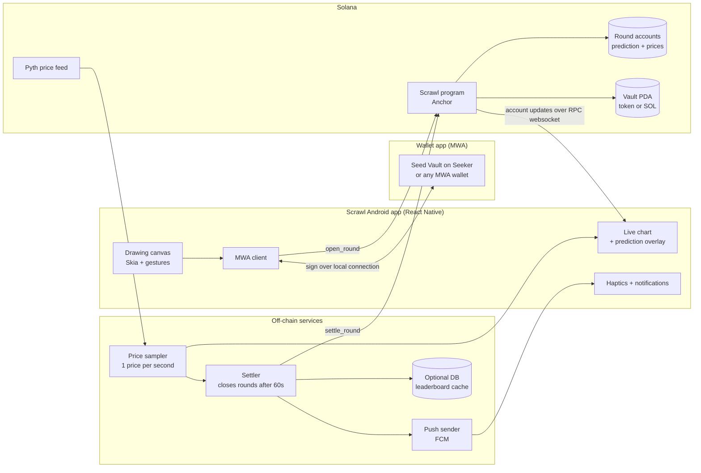
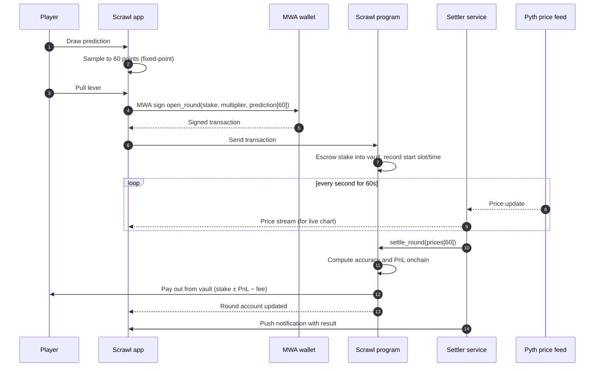
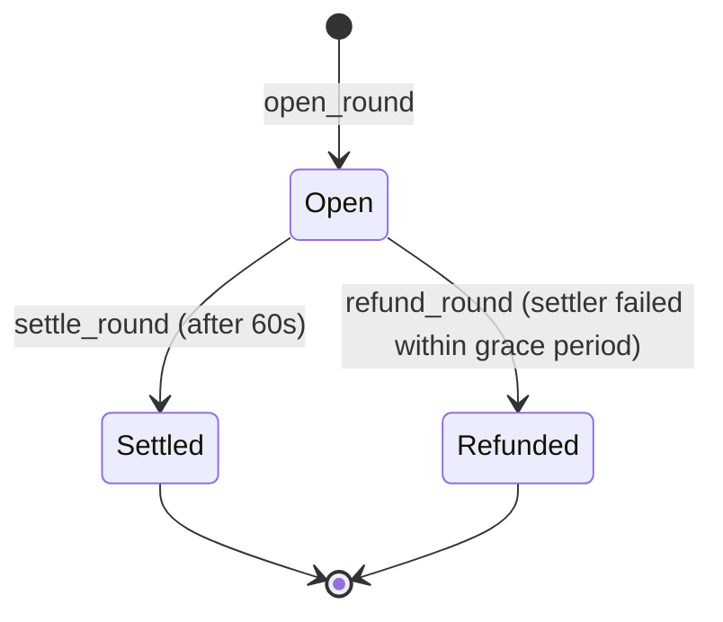

# Scrawl

> **Draw the price. Beat the chart.**
> A mobile prediction game on Solana: sketch where you think the price goes in the next 60 seconds, lock it in with one tap, and get scored on how closely your line follows reality.

Built for **Clock In: A Solana Mobile Hackathon** (Android, Mobile Wallet Adapter, Solana dApp Store).

> **Porting disclosure:** Scrawl is a ground-up Solana and Android rebuild of **Resolv.Fi**, an earlier web prototype that ran on Mantle with EigenDA. The game idea and scoring model carry over. The mobile app, the Solana program, the oracle integration and the wallet flow are new. See [What's new vs. the web prototype](#whats-new-vs-the-web-prototype).

---

## Table of contents

1. [The idea](#the-idea)
2. [How a round works](#how-a-round-works)
3. [Scoring](#scoring)
4. [Architecture](#architecture)
5. [Round flow](#round-flow)
6. [Solana integration](#solana-integration)
7. [Onchain program design](#onchain-program-design)
8. [Mobile-native features](#mobile-native-features)
9. [Trust model and limitations](#trust-model-and-limitations)
10. [What's new vs. the web prototype](#whats-new-vs-the-web-prototype)
11. [Tech stack](#tech-stack)
12. [Repository structure](#repository-structure)
13. [Getting started](#getting-started)
14. [Environment variables](#environment-variables)
15. [Building the APK](#building-the-apk)
16. [Demo script (3 minutes)](#demo-script-3-minutes)
17. [Status](#status)
18. [Roadmap](#roadmap)
19. [Publishing to the Solana dApp Store](#publishing-to-the-solana-dapp-store)
20. [Hackathon criteria mapping](#hackathon-criteria-mapping)
21. [Team and license](#team-and-license)

---

## The idea

Trading apps ask you to pick a side: long or short, with order books, leverage sliders and margin math. Most people find that intimidating, even when they have a feel for where a price is heading.

Scrawl replaces the order ticket with something anyone can do: **draw a line.** You sketch your prediction for the next 60 seconds of a price chart with your finger. The app samples your drawing into 60 points, locks it onchain, and then scores how well your line matched the shape of the real price movement.

It rewards **pattern recognition**, not just calling one direction, and a round lasts one minute, so it suits short, repeated play on a phone.

## How a round works

1. **Connect** your wallet through Mobile Wallet Adapter (Seed Vault on a Seeker, or any MWA wallet).
2. **Draw** your prediction left to right on the canvas. The live price is shown behind it.
3. **Choose** your stake and multiplier.
4. **Pull the lever.** A haptic "click", then a single wallet signature places the round.
5. **Watch** the real price draw itself over your line for 60 seconds.
6. **Settle.** The program scores the round and pays out, and you get a notification with the result.

## Scoring

Scrawl keeps the **point-by-point directional** model from the web prototype. A drawing is 60 points, which gives 59 steps. For each step, the program checks whether your line and the real price moved in the same direction (up, down, or flat).

```
accuracy = correct_steps / 59

pnl = (2 × accuracy − 1) × max_profit

max_profit = |price_end − price_start| × position_size × multiplier
position_size = stake / price_start
```

| Accuracy | Result |
|---|---|
| 100% | Maximum profit |
| 50% | Break-even |
| 0% | Maximum loss (stake) |

A small fee is taken on profits only (default 2%).

**Multiplier:** the web prototype allowed 100x to 2,500x. For Scrawl the suggested default is a **low cap (for example up to 10x)**, because very high leverage on a one-minute game is both risky for users and likely to cause problems with dApp Store review. This is a product decision for the team to confirm.

All math runs in **integer fixed-point arithmetic** in the program. No floating point.

---

## Architecture



**Design rule:** a player's drawing and the price series both end up **onchain**, and the program computes the score itself. The settler only supplies prices and cannot choose a score.

## Round flow



### Round lifecycle



---

## Solana integration

### Mobile Wallet Adapter and Solana Mobile Stack

- Wallet connection and all signing go through **Mobile Wallet Adapter (MWA)**. Keys never enter the Scrawl app.
- On a **Seeker**, signing uses **Seed Vault**, so the key stays in secure hardware.
- Any MWA-compatible wallet works on a regular Android phone, which keeps the demo easy to reproduce.
- Packages: `@solana-mobile/mobile-wallet-adapter-protocol-web3js` and `@solana-mobile/mobile-wallet-adapter-protocol`.
- MWA connects apps on the same device, so it must be tested on a **real phone** with a wallet installed.

### Anchor program

The game logic lives in an **Anchor** program. It holds funds in a vault (a program-derived account), stores each round as an account, and calculates scores itself. See [Onchain program design](#onchain-program-design).

### Oracle: Pyth

- Prices come from a **Pyth** feed (SOL/USD for the first version).
- The settler samples one price per second and submits the 60-price series.
- Roadmap: have `settle_round` read Pyth price accounts directly, so the program verifies the prices instead of trusting the settler. Verify the current Pyth Solana integration pattern in their docs before building this part.

### Why Solana fits this game

- Storing the prediction (60 values) and the price series (60 values) in an account is cheap, which removes the need for the EigenDA data-availability layer used in the web prototype.
- Fast confirmation means a 60-second round can start almost immediately after you sign.
- A single signature per round keeps the phone flow to one tap.

### Network

| Component | Cluster |
|---|---|
| Program, vault, rounds | Devnet |
| Price feed | Pyth (devnet or mainnet reference, see Known limitations) |

Program ID: `TODO_after_deploy` (fill in after `anchor deploy`).

---

## Onchain program design

> Account layout and instructions below are the intended design. Adjust to match the code.

### Accounts

| Account | Seeds | Contents |
|---|---|---|
| `Config` | `["config"]` | admin, settler pubkey, fee bps, max multiplier, min/max stake, round duration |
| `Vault` | `["vault"]` | holds staked funds and the payout pool (token account or SOL PDA) |
| `Round` | `["round", player, round_id]` | player, stake, multiplier, open time, `prediction: [i32; 60]`, `prices: [u64; 60]`, status, pnl, payout |
| `PlayerStats` | `["stats", player]` | rounds played, total pnl, win count, best round |

### Instructions

| Instruction | Who | What it does |
|---|---|---|
| `initialize` | admin | Sets config and creates the vault |
| `fund_vault` | admin | Adds liquidity to the payout pool |
| `open_round` | player | Validates stake and multiplier, escrows the stake, stores the 60-point prediction, records start time |
| `settle_round` | settler | After 60s, stores the 60 prices, computes accuracy and PnL with fixed-point math, pays out, updates stats |
| `refund_round` | anyone | If the settler has not settled within a grace period, returns the stake in full |
| `update_config` | admin | Adjusts fee, limits and settler |

### Checks the program enforces

- Stake within min and max, multiplier within the cap.
- Prediction points within a valid range and exactly 60 values.
- `settle_round` only after the round duration has passed.
- A round can be settled once.
- Payout never exceeds what the vault holds (max loss is the stake; max profit is capped by the vault balance).
- Only the configured settler can call `settle_round`.

---

## Mobile-native features

- **Touch drawing canvas** built for fingers, with smoothing and a live "ghost" of the price behind it
- **Haptics**: a tick while drawing, a heavier "lever" pulse on lock-in, and a result pulse on settlement
- **Lever interaction**: a swipe-down gesture instead of a plain button, which feels deliberate and fun
- **Push notifications** when a round settles, with the result
- **Mobile Wallet Adapter** signing, with Seed Vault support on Seeker
- **Portrait-first layout** sized for one-handed play
- **Quick replay loop**: finish a round, and start the next one in two taps

---

## Trust model and limitations

**Trust**

| Component | Trusted? | Notes |
|---|---|---|
| Program | Verifiable | Scoring and payouts are computed onchain |
| Settler | **Partially** | Supplies the price series. It cannot change your prediction or the scoring rule, but a dishonest settler could submit wrong prices |
| Pyth feed | Oracle trust | Standard oracle assumptions |
| Wallet | Yes | Holds the keys; signs through MWA |

**Mitigations:** the prediction is locked onchain before prices exist; `refund_round` protects players if the settler goes offline; prices are stored onchain so anyone can audit a round afterwards; the roadmap moves price verification into the program.

**Known limitations (be upfront about these)**

- Hackathon prototype, **not audited**. Devnet funds only.
- The vault is **house-funded** for the demo. A sustainable version needs LPs or player-vs-player pools.
- The settler is a trusted service in this version.
- Pyth devnet feeds may be less reliable than mainnet. If prices are unavailable, the demo may use a clearly labeled replay of recorded prices.
- This is a **skill-and-prediction game with stakes**. Check local rules and the dApp Store policy before any mainnet launch.
- Android only.

---

## What's new vs. the web prototype

| Area | Resolv.Fi (web prototype) | Scrawl (this submission) |
|---|---|---|
| Chain | Mantle (EVM, Solidity) | Solana (Anchor, Rust) |
| Client | Next.js web app | **Native Android app**, React Native |
| Wallet | RainbowKit / wagmi | **Mobile Wallet Adapter** / Seed Vault |
| Data availability | EigenDA commitments | Prediction and prices stored directly in program accounts |
| Scoring | Computed by a backend PnL server | **Computed onchain** by the program |
| Oracle | Bybit WebSocket via backend | Pyth feed via settler (roadmap: verified onchain) |
| Input | Mouse on a canvas | **Touch drawing**, haptics, swipe lever |
| Notifications | None | Push on settlement |
| Multiplier | 100x to 2500x | Lower cap (suggested 10x) |

*The commit history shows the mobile and Solana work.*

---

## Tech stack

| Layer | Choice |
|---|---|
| Mobile app | React Native (Expo dev build or bare), TypeScript, Android only |
| Drawing and graphics | `@shopify/react-native-skia`, `react-native-gesture-handler`, `react-native-reanimated` |
| Wallet | `@solana-mobile/mobile-wallet-adapter-protocol-web3js` |
| Solana client | `@solana/web3.js`, `@coral-xyz/anchor` |
| Program | Rust, Anchor |
| Oracle | Pyth |
| Push | Firebase Cloud Messaging |
| Settler service | Node.js, TypeScript |
| Haptics | `expo-haptics` |
| Fonts | Plus Jakarta Sans (UI), Geist Mono (numbers) |

MWA and push need native modules, so **Expo Go will not work**. Use a development build.

---

## Repository structure

```
scrawl/
├── programs/
│   └── scrawl/             # Anchor program (Rust)
│       └── src/
│           ├── lib.rs
│           ├── state.rs    # Config, Round, PlayerStats
│           ├── scoring.rs  # fixed-point accuracy and PnL
│           └── instructions/
├── app/                    # React Native Android app
│   └── src/
│       ├── screens/        # Play, Round, Result, History, Settings
│       ├── components/     # DrawCanvas, LiveChart, Lever
│       ├── solana/         # mwa.ts, program client, idl
│       └── push/
├── settler/                # Price sampler and settler service
├── tests/                  # Anchor tests (scoring and settlement cases)
├── docs/                   # Deck, diagrams, screenshots
└── README.md
```

---

## Getting started

### Prerequisites

- Node.js 20+
- Rust, Solana CLI, and Anchor
- Android Studio, and a **real Android phone** with USB debugging on
- An MWA-compatible wallet installed on the phone
- A Firebase project (`google-services.json`)
- Devnet SOL for the deployer, the settler and the test wallet

### 1. Build and deploy the program

```bash
git clone https://github.com/<your-org>/scrawl.git
cd scrawl

anchor build
anchor test            # runs scoring and settlement tests
anchor deploy --provider.cluster devnet
```

Copy the deployed program ID into `Anchor.toml`, the app and the settler config. Then call `initialize` and `fund_vault` (a script is provided in `settler/scripts/`).

### 2. Run the settler

```bash
cd settler
cp .env.example .env
npm install
npm run dev
```

### 3. Run the app on your phone

```bash
cd app
npm install
npx expo prebuild --platform android
npx expo run:android --device
```

Place `google-services.json` in `app/android/app/` first.

---

## Environment variables

`settler/.env`

```
SOLANA_RPC_URL=https://api.devnet.solana.com
PROGRAM_ID=<deployed program id>
SETTLER_KEYPAIR_PATH=./settler-keypair.json
PYTH_PRICE_FEED_ID=<SOL/USD feed id from Pyth docs>
FIREBASE_SERVICE_ACCOUNT_JSON=./firebase-service-account.json
ROUND_DURATION_SECONDS=60
```

`app/.env`

```
EXPO_PUBLIC_SOLANA_RPC_URL=https://api.devnet.solana.com
EXPO_PUBLIC_PROGRAM_ID=<deployed program id>
EXPO_PUBLIC_SETTLER_URL=http://<your-lan-ip>:3000
```

Never commit keypairs, service-account JSON or `.env` files.

---

## Building the APK

```bash
cd app/android
./gradlew assembleRelease
# output: app/android/app/build/outputs/apk/release/app-release.apk
```

Sign the release build with your own keystore, install it with `adb install`, and test it on a real device before submitting. Host the APK at a direct download link (for example a GitHub Release asset) and check the link in an incognito window.

---

## Demo script (3 minutes)

| Time | What is shown |
|---|---|
| 0:00–0:20 | The hook: "Trading apps ask you to pick a side. Scrawl asks you to draw." |
| 0:20–0:50 | Connect with MWA, then draw a prediction on the canvas with haptics |
| 0:50–1:20 | Swipe the lever, sign once in the wallet, and show the round opening onchain (explorer link) |
| 1:20–2:10 | The live 60-second round: real price drawing over the user's line, accuracy ticking up |
| 2:10–2:35 | Settlement: result screen, payout, push notification, and the round account on the explorer |
| 2:35–3:00 | Architecture slide, what is onchain, what is trusted, the roadmap. State clearly if any price data is a replay |

Tips: record on the real device, show the explorer link for both transactions, and show the push arriving.

---

## Status

Update this honestly before submitting.

| Feature | Status |
|---|---|
| Anchor program: open, settle, refund | [ ] |
| Onchain fixed-point scoring and tests | [ ] |
| MWA connect and sign on a real device | [ ] |
| Touch drawing canvas | [ ] |
| Live chart with prediction overlay | [ ] |
| Settler service and price sampling | [ ] |
| Push notification on settlement | [ ] |
| Haptics and lever gesture | [ ] |
| Leaderboard / stats screen | [ ] stretch |
| Onchain Pyth price verification | [ ] stretch |
| dApp Store listing | [ ] after winners announced |

## Roadmap

- Verify prices onchain from Pyth inside `settle_round`
- Player-vs-player rounds and community-funded pools instead of a house vault
- More assets and longer or shorter round lengths
- Daily challenges and streaks
- Shareable replays of your best scrawls
- iOS
- Mainnet launch after an audit and a policy review

---

## Publishing to the Solana dApp Store

Winners must publish within 30 days of the announcement.

1. Produce a signed release APK.
2. Prepare listing assets (icon, screenshots, description, publisher details).
3. Follow the current Solana dApp Store publishing guide for the submission steps, since they change over time.
4. Review the store's content policy for games with stakes before submitting.

---

## Hackathon criteria mapping

| Criterion (25% each) | How Scrawl addresses it |
|---|---|
| **Stickiness and PMF** | One-minute rounds, an instant replay loop, streaks and daily challenges, and a result push every time you play |
| **User experience** | One drawing, one swipe, one signature. Haptics, a live overlay, and no trading jargon |
| **Innovation / X-factor** | Drawing as the input, scored onchain by pattern accuracy instead of a long or short order |
| **Presentation and demo** | A clear one-line hook, a live round on a real device, and explorer links for each onchain step |

Also covered: **Solana Mobile Stack and MWA**, Android APK, meaningful Solana interaction, mobile-first design.

---

## Team and license

Built by **[team name and members]**.

Based on the earlier web prototype Resolv.Fi.

License: MIT (add a `LICENSE` file).